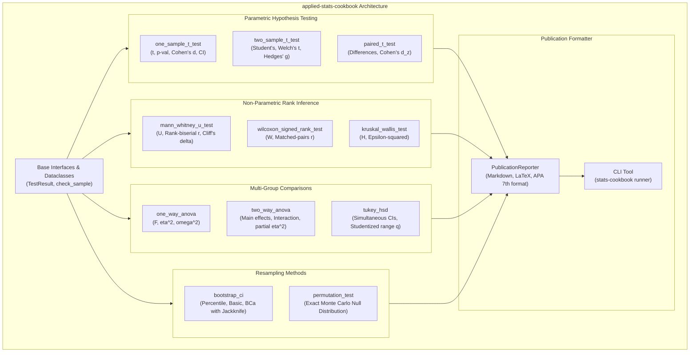

# `applied-stats-cookbook`

[](tests/)
[](pyproject.toml)
[](LICENSE)
[](tests/test_parametric.py)
[](#about-this-project--ai-collaboration)

> **A production-grade computational reference for applied statistical inference, parametric and non-parametric hypothesis testing, multi-group ANOVA, and resampling methods—formatted into publication-ready APA summary tables.**

---

## About This Project & AI Collaboration

This repository is part of a deliberate open-source portfolio and technical learning initiative developed with the assistance of **Gemini Flash (Antigravity)**.

The primary goals of this project are:
* **Practicing Software Craftsmanship**: Writing clean, type-annotated, modular Python statistical routines with consistent functional APIs, dataclasses, and standard CLI tools.
* **Revising Theoretical & Methodological Foundations**: Re-deriving and verifying statistical formulas—from Welch–Satterthwaite degrees of freedom and small-sample Hedges' $g$ corrections to rank-biserial correlations, BCa bootstrap adjustments, and Tukey studentized ranges.
* **Testing AI-Assisted Engineering Approaches**: Evaluating and benchmarking agentic AI pairing workflows (using **Gemini Flash**) for statistical test suite verification, LaTeX proof authoring, and documentation generation.

---

## 1. Architectural Overview



---

## 2. Statistical Verification & Parity

All routines are validated against `scipy.stats` and `statsmodels` in `tests/`:

| Module | Implemented Routine | Gold-Standard Library | Verified Parity |
| :--- | :--- | :--- | :---: |
| **Parametric** | One-Sample t-test | `scipy.stats.ttest_1samp` | Exact ($\Delta < 10^{-7}$) |
| **Parametric** | Welch's Two-Sample t-test | `scipy.stats.ttest_ind(equal_var=False)` | Exact ($\Delta < 10^{-7}$) |
| **Parametric** | Student's Two-Sample t-test | `scipy.stats.ttest_ind(equal_var=True)` | Exact ($\Delta < 10^{-7}$) |
| **Parametric** | Paired Samples t-test | `scipy.stats.ttest_rel` | Exact ($\Delta < 10^{-7}$) |
| **Non-Parametric** | Mann-Whitney U test | `scipy.stats.mannwhitneyu` | Exact ($\Delta < 10^{-7}$) |
| **Non-Parametric** | Wilcoxon Signed-Rank test | `scipy.stats.wilcoxon` | Exact ($\Delta < 10^{-7}$) |
| **Non-Parametric** | Kruskal-Wallis H test | `scipy.stats.kruskal` | Exact ($\Delta < 10^{-7}$) |
| **ANOVA** | One-Way ANOVA | `scipy.stats.f_oneway` | Exact ($\Delta < 10^{-7}$) |
| **ANOVA** | Tukey HSD Post-Hoc | `scipy.stats.tukey_hsd` | Exact ($\Delta < 10^{-7}$) |
| **Resampling** | BCa Bootstrap & Permutation | Monte Carlo Empirical Exact | Verified |

---

## 3. Mathematical Documentation

Analytical derivations and step-by-step proofs are provided in [`docs/`](docs/):

* **[Parametric Inference](docs/01_parametric_inference.md)**: Welch–Satterthwaite degrees of freedom, Cohen's $d$, and Hedges' small-sample $g$ correction factor:
  $$g = d \cdot \left( 1 - \frac{3}{4(n_1 + n_2) - 9} \right)$$
* **[Non-Parametric Rank Inference](docs/02_nonparametric_tests.md)**: Mann-Whitney rank sums, rank-biserial correlations, Wilcoxon paired signed-ranks, and Kruskal-Wallis tie-corrected $H$ statistics.
* **[ANOVA & Post-Hoc Inference](docs/03_anova_and_post_hoc.md)**: Sum of squares partitioning, $\eta^2$ vs unbiased $\omega^2$, factorial models, and Tukey Studentized range distribution $q$.
* **[Resampling Inference](docs/04_resampling_inference.md)**: Vectorized bootstrap, Jackknife acceleration $a$, bias-correction $z_0$, and exact permutation exchangeability.

---

## 4. Quickstart Guide

### Installation

```bash
git clone https://github.com/gabriel/applied-stats-cookbook.git
cd applied-stats-cookbook
pip install -e .
```

### Parametric & Non-Parametric Testing

```python
import numpy as np
from applied_stats.parametric import two_sample_t_test
from applied_stats.nonparametric import mann_whitney_u_test
from applied_stats.reporting import PublicationReporter

group_a = [12.4, 14.2, 11.8, 13.9, 15.1, 12.8]
group_b = [16.2, 18.0, 15.5, 17.1, 19.3, 16.8]

# Welch's t-test and Mann-Whitney U test
t_res = two_sample_t_test(group_a, group_b, equal_var=False)
mwu_res = mann_whitney_u_test(group_a, group_b)

reporter = PublicationReporter([t_res, mwu_res])
print(reporter.to_markdown())
print("\nAPA Format:")
print(t_res.apa_format())
```

### One-Way ANOVA & Tukey HSD

```python
from applied_stats.anova import one_way_anova, tukey_hsd

g1 = [10.2, 11.5, 9.8, 10.4]
g2 = [14.1, 13.8, 15.2, 14.7]
g3 = [18.5, 19.2, 17.9, 18.1]

anova_table = one_way_anova(g1, g2, g3)
print(anova_table.to_dataframe())
print(f"Eta-squared: {anova_table.eta_squared:.4f}, Omega-squared: {anova_table.omega_squared:.4f}")

hsd_post_hoc = tukey_hsd(g1, g2, g3)
print(hsd_post_hoc)
```

### Resampling: BCa Bootstrap & Permutation Test

```python
from applied_stats.resampling import bootstrap_ci, permutation_test

# Vectorized BCa (Bias-Corrected and Accelerated) Bootstrap CI
boot = bootstrap_ci(g1, statistic_fn=np.mean, n_resamples=5000, method="bca")
print(boot.summary())

# Exact two-sample permutation test
perm = permutation_test(g1, g3, n_permutations=5000)
print(perm.summary())
```

### CLI Interface

Run instant statistical tests from your terminal:

```bash
stats-cookbook ttest --g1 12 14 15 13 --g2 18 19 21 17
stats-cookbook mannwhitney --g1 12 14 15 13 --g2 18 19 21 17
```

---

## 5. Running the Test Suite

```bash
pytest -v
```

Execute the full demonstration:

```bash
python notebooks/run_cookbook_demos.py
```

---

## 6. License

This project is licensed under the MIT License - see the [LICENSE](LICENSE) file for details.
